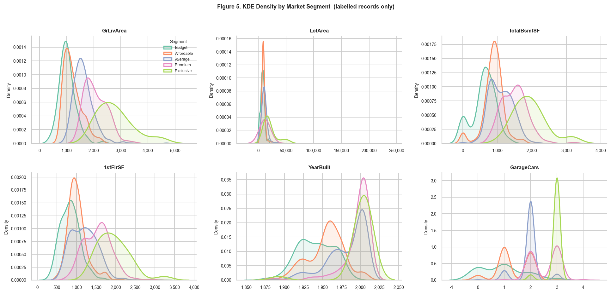
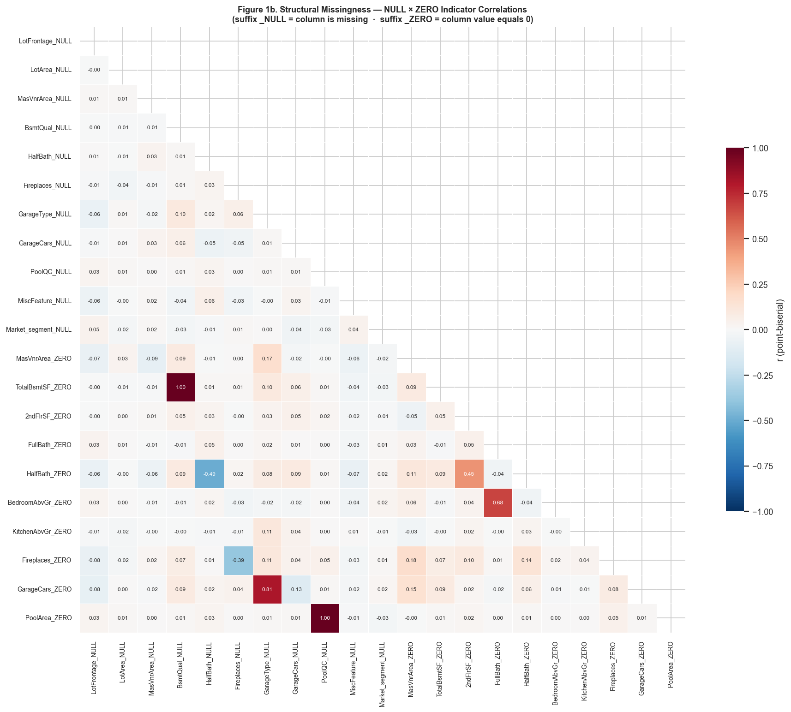
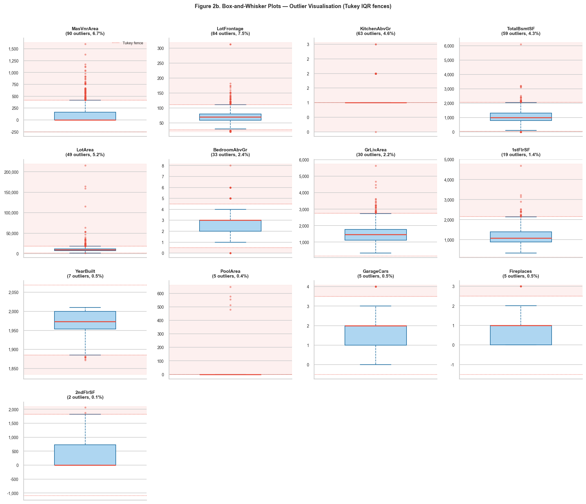

# De datos sucios a un *gold standard*: curación, reglas de negocio y etiquetado de viviendas

> 1 359 viviendas, 27 atributos y un 30 % de huecos en algunas columnas. 100 de ellas, además, sin
> segmento de mercado. Este repo cuenta cómo pasar de ese fichero en bruto a un dataset en el que se
> puede confiar, y cómo rellenar las etiquetas que faltan sin inventárselas.

| Versión del dataset | Filas | Completitud | Consistencia |
|---|---|---|---|
| Original | 1 359 | 0.876 | 0.891 |
| Curado | 1 234 | 1.000 | 0.861 |
| Cumple todas las reglas de negocio | 1 055 | 1.000 | **1.000** |



---

## Índice

- [El giro de guion](#el-giro-de-guion)
- [Acto I: limpiar sin romper nada](#acto-i-limpiar-sin-romper-nada)
- [Acto II: poner reglas al negocio](#acto-ii-poner-reglas-al-negocio)
- [Acto III: etiquetar lo que falta](#acto-iii-etiquetar-lo-que-falta)
- [Lo que me llevo](#lo-que-me-llevo)
- [Si tuviera otra semana](#si-tuviera-otra-semana)
- [Cómo ejecutarlo](#cómo-ejecutarlo)

---

## El giro de guion

Fíjate en la tabla de arriba: **la consistencia empeora después de limpiar**. No es un error de la
tabla, es el hallazgo más interesante del proyecto. Recortar los outliers de cada columna por
separado rompía en silencio la identidad `GrLivArea = 1stFlrSF + 2ndFlrSF` en 34 viviendas. Solo se
descubrió porque las reglas de negocio se comprobaron *después* de curar. Moraleja: la limpieza
también hay que validarla.

## Acto I: limpiar sin romper nada



- **No todos los nulos son iguales.** Una casa sin garaje no tiene "tipo de garaje": eso no es un
  dato perdido, es un dato que no existe. Correlacionar los indicadores de nulo y de cero separa los
  nulos estructurales de los reales antes de imputar nada.
- **Cada variable, su tratamiento:** estructural, imputable o eliminable. Se conserva el 98.4 % de los
  registros.
- **Outliers con criterio:** IQR con k = 1.5 en general y k = 3 en las variables de cola pesada.
- **Sin fugas:** las estadísticas de imputación salen solo de las viviendas etiquetadas, para que las
  100 sin etiquetar no contaminen el proceso.



## Acto II: poner reglas al negocio

El conocimiento del dominio, convertido en tests automáticos con **Great Expectations**: límites
físicos, coherencia entre superficies, habitabilidad mínima, años de construcción y reforma, garaje y
sótano coherentes, y duplicados. La calidad se mide en seis dimensiones (completitud, unicidad,
validez, exactitud, consistencia e integridad) para las tres versiones del dataset.

## Acto III: etiquetar lo que falta

Tres formas de poner etiqueta a 100 viviendas, comparadas con una métrica compuesta (F1, silhouette y
entropía):

| Método | Idea | Veredicto |
|---|---|---|
| **Manual** | Reglas jerárquicas sobre superficie, año, baños y chimeneas, elegidas por correlación de Spearman, más un índice de calidad | Mejor puntuación: elegido como *gold standard* |
| Heurística H1 → H3 | De una sola variable a un score ponderado por Spearman | H3 gana: la alternativa automática más escalable |
| Clustering | KMeans (codo + silhouette) y DBSCAN (gráfico de k-distancias) | KMeans supera a DBSCAN, pero las viviendas forman un continuo, no grupos separados |

## Lo que me llevo

- Validar con reglas *después* de curar es lo que destapa los efectos secundarios de la limpieza.
- Para etiquetar, el criterio humano guiado por el EDA sigue ganando; H3 es la mejor opción si hay que
  automatizar, y el clustering sirve más para *entender* los datos que para etiquetarlos.
- Elegir el *gold standard* con una métrica compuesta evita premiar etiquetados que aciertan mucho pero
  desequilibran las clases.

## Si tuviera otra semana

- Recortar outliers respetando las identidades: recortar `1stFlrSF` y `2ndFlrSF` y recalcular
  `GrLivArea` como su suma.
- Comparar varias estrategias de imputación con un criterio medible.
- Análisis de sensibilidad de los hiperparámetros de DBSCAN.

## Cómo ejecutarlo

Python con `pandas`, `numpy`, `scipy`, `scikit-learn`, `matplotlib`, `seaborn` y `great_expectations`.
Ejecuta los notebooks en orden: el primero genera el dataset que consume el segundo.

```
01_curacion_y_reglas.ipynb  EDA, curación y reglas de negocio
02_etiquetado.ipynb         etiquetado manual, heurístico y por clustering
homes_dataset.csv           dataset original
homes_rules_compliant.csv   dataset que cumple todas las reglas
datasets/                   dataset curado y los tres candidatos etiquetados
memoria.pdf                 memoria del proyecto
figures/                    gráficas extraídas de los notebooks
```

---

Proyecto en equipo desarrollado durante el Grado en Ingeniería de Sistemas de Inteligencia Artificial
(Universidad Francisco de Vitoria, 2025/26). Autor del repositorio: Marco Larriba Rius.
